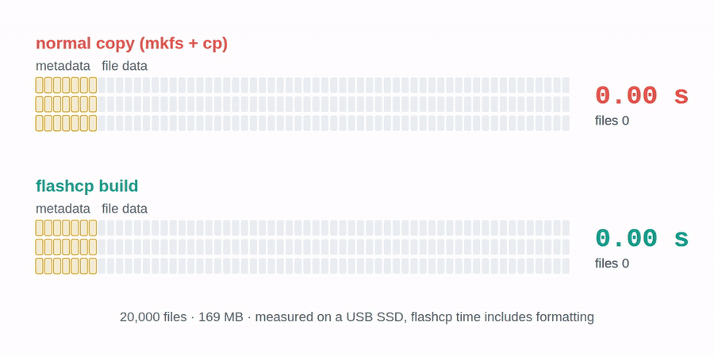
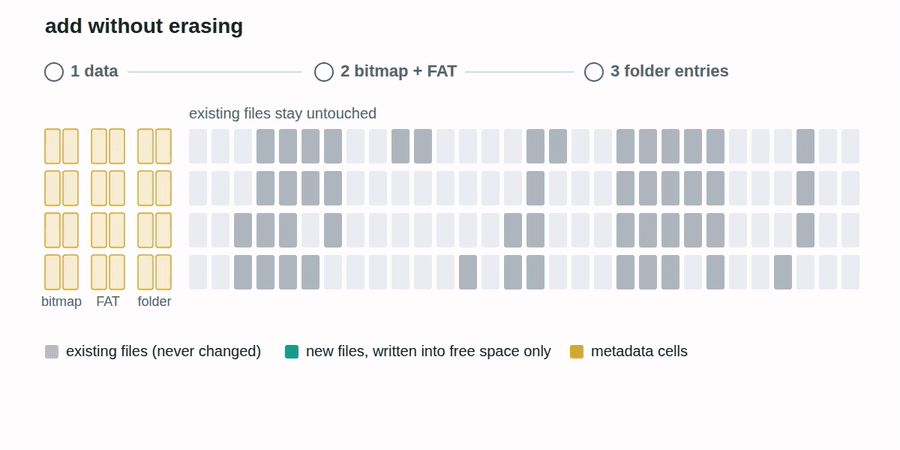
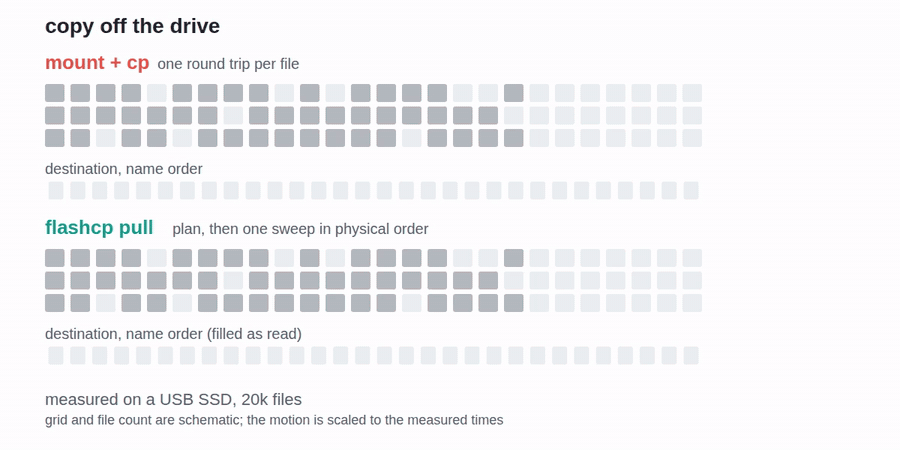

<div align="center">

# flashcp

**Copying thousands of small files to a USB stick is slow. flashcp makes it fast, and the drive
stays a normal exFAT drive that Windows, macOS and Linux read like any other.**

[](https://github.com/zuhuHix/flashcp/actions/workflows/ci.yml)
[](https://github.com/zuhuHix/flashcp/actions/workflows/xos.yml)
[](LICENSE)
[](https://zuhuhix.github.io/flashcp/)
[](https://buymeacoffee.com/zuhu)

<picture>
  <source media="(prefers-color-scheme: dark)" srcset="assets/drive-mode-dark.gif">
  
</picture>

**[▶ Try the interactive benchmark explorer](https://zuhuhix.github.io/flashcp/)**

</div>

The animation is one measured copy: 20,000 small files (169 MB) onto a Kingston DataTraveler 3.0
USB 3 stick with 4 KB clusters. Through flashcp's driver the stick could be removed after
**5.3 s**. With the Linux kernel driver, on the same stick and the same format, copying and
unmounting took **50 s in one run and about 72 s in another**: roughly 10× longer (single runs,
and this stick varies). On a stick formatted the usual way the same copy took 94 s against 259–371 s, and
[the cluster size is the reason](#why-a-normally-formatted-stick-is-slow). Photos, music and other
big files gain little: see [when not to expect gains](#when-not-to-expect-gains). Every number, with
its drive, dataset and baseline, is in the [benchmarks](#benchmarks).

flashcp runs on Linux, and there are two ways to use it:

- **[Drive mode](#drive-mode): nothing to open.** With the desktop package installed, eligible USB
  exFAT drives are served by flashcp's own driver, so a copy from any app (the file manager, a
  browser download, `cp`, `rsync`) goes through it. A drive that is busy or fails the clean-volume
  check falls back to the kernel driver. Drive mode is in the next release (0.3.0).
- **Commands**, in the current release (0.2.0), for whole jobs on an unmounted drive:
  - **`flashcp build`** writes a whole new exFAT drive in one stream. **It erases the drive.**
  - **`flashcp add`** adds a folder to a drive that already has files, without erasing anything.
  - **`flashcp pull`** copies files off a drive, reading it front to back in physical order.
  - **`flashcp sync`** makes a folder on the drive match a local folder, writing only what
    changed, with a crash-safe journal. See [Sync](#sync-copy-only-what-changed).
  - **`flashcp optimize`** rewrites a stick that was filled file by file into the fast layout.
    Your files are kept.

Why it is faster: on a normal copy every file costs a directory entry, an allocation-table update
and a bitmap update, all tiny writes scattered across the disk, and every one is a separate trip
over USB. flashcp reads and writes exFAT itself, so it turns all of that into **one ordered pass**.
What you get is an ordinary exFAT drive with ordinary files on it (checked on Windows and macOS in
CI, see [Compatibility](#compatibility)). There's a command-line tool and a
[desktop tray app](#desktop-app).

## Contents

[Drive mode](#drive-mode) · [Why a normally formatted stick is slow](#why-a-normally-formatted-stick-is-slow) ·
[When not to expect gains](#when-not-to-expect-gains) · [Install](#install) · [Desktop app](#desktop-app) ·
[Quick start](#quick-start) · [Benchmarks](#benchmarks) · [Compatibility](#compatibility) ·
[How it works](#how-it-works) · [The journey](#the-journey) · [Command reference](#command-reference) ·
[Honest limits](#honest-limits) · [Roadmap](#roadmap) · [Support](#support) · [Contributing](#contributing)

## Drive mode

> [!NOTE]
> Drive mode is merged and ships in the next release, **0.3.0**. The current release (0.2.0)
> does not have it. To use it today, build both packages from `main`
> ([packaging/desktop/README.md](packaging/desktop/README.md)).

**What it is.** Once the [desktop package](#desktop-app) is installed, eligible USB exFAT drives
are served by flashcp's own exFAT driver (`flashcp mount`, a userspace FUSE driver) instead of the
kernel's, so copies from any app (the file manager, `cp`, `rsync`) go through flashcp. A drive
that is busy or fails the clean-volume check falls back to the kernel driver.
Linux only.

**What you see.** The drive appears as usual at `/media/<user>/<LABEL>`.
Eject shows "Saving N MB to LABEL…" and then "LABEL can be removed". If you pull the drive out
while data is still being saved, a warning names what may be missing, and the next plug-in
repairs the drive from its journal. Drives that aren't clean exFAT, or that are busy, fall back
to the normal kernel driver, exactly as without flashcp.

**When your files are on the drive.** flashcp writes behind your apps: a copy lands in memory
first and is then written to the drive in order, so an app can be done before the drive is.

- **Eject is the guarantee.** Use Eject (in the file manager, the tray, or
  `flashcp drive-mode eject <device>`) and wait for "can be removed".
- Closing a file starts saving it 150 ms later. A `cp -r` of many files is saved as one batch,
  150 ms after its last file. For a file that an app keeps open, saving starts within 1 s of its
  last write.
- A program that calls `fsync` on a file (an explicit save in most editors) waits until that
  file is on the drive.
- **`sync` is not a guarantee.** Linux never forwards `sync`, `sync -f` or `syncfs` to a driver
  like this one, so `cp … && sync` returns before the data is on the drive
  ([#24](https://github.com/zuhuHix/flashcp/pull/24)). Eject instead.
- At most 256 MB is staged at a time. Past that, apps wait for the drive.

**What it measured.** 20,000 small files (169 MB), until the drive is safe to remove:

| Drive | Linux kernel driver | drive mode | |
|---|---:|---:|---:|
| Kingston DataTraveler 3.0 (USB 3), 4 KB clusters | 50.3 s, and about 72 s in another run (copy + unmount) | **5.31 s** (1 run) | about 9–14× sooner |
| Kingston DataTraveler 3.0 (USB 3), default 128 KB clusters | 259–289 s ending with an unmount, up to 371 s with a final `sync` | **93.8 s** (94.7 s on a second build) | 2.8–3.1× sooner, up to 4.0× against a final `sync` |
| MSI DATAMAG USB SSD (UAS) | 1.80 s | **1.26 s** | 1.4× sooner (medians of 3) |

The Kingston rows are single runs. Its 128 KB kernel figures are whole runs, formatting and
mounting included, which is under 1 s of them (measured 0.46 s). The animation's 0.9 s is the
measured return of one `cp -r` of the 20,000 files; the three apps are an illustration.

One cost: `cp` itself often *returns* later than with the kernel driver (about 2× in most
tests), while the data is on the drive sooner. The baselines, the read-back times and that
caveat are in [Drive mode benchmarks](#drive-mode-flashcp-mount-vs-the-kernel-exfat-driver).

**How to turn it off.** The **Speed up USB drives** switch in the app or the tray menu, or
`flashcp drive-mode off` (per user; current drives are saved and remounted by the kernel driver).
For every user: `sudo flashcp drive-mode off --system`. Uninstalling the desktop package restores
normal automount.

**The safety model.**
- Every metadata write goes through a crash-safe journal on the drive (`/.flashcp-drive-journal`).
- After a crash or a yank, the drive holds the old tree or the new one, never a mix. A crash
  test at every device write checks this, and so did crash tests on the real drives.
- Data that was still waiting to be saved when the drive was yanked is lost, as with the
  kernel's page cache. The warning says how much.
- The plug-in check that reads an unknown drive runs sandboxed in a transient systemd unit: a
  throwaway user, no network, no access to your files, and the device opened read-only.

Details: [packaging/desktop/README.md](packaging/desktop/README.md#drive-mode-speed-up-usb-drives-on-by-default),
[DESIGN.md](DESIGN.md), [SECURITY-NOTES.md](packaging/desktop/SECURITY-NOTES.md#drive-mode-flashcp-udev-check).

## Why a normally formatted stick is slow

<picture>
  <source media="(prefers-color-scheme: dark)" srcset="assets/cluster-slack-dark.gif">
  
</picture>

exFAT stores files in clusters, and a file always takes whole ones. `mkfs.exfat`, Windows and
macOS choose big clusters for big drives: 128 KB on a 128 GB stick, 32 KB on an 8 GB one. A 6 KB
file then owns 128 KB of the stick.

For the 20,000-file test set (169 MB, 8.4 KB per file on average) that turned into **2.6 GB** of
writing on the Kingston stick (the device counted 2,525 MiB). A driver can either fill each
file's unused space with zeros or jump over it 20,000 times, and on this stick filling is the
faster of the two: with `flashcp add`, filling took 89.7 s, jumping 144 s, and padding each file
to 16–64 KB 129–190 s. With 4 KB clusters the same files are 211 MB of writing.

Same stick, same files, same driver (drive mode, single runs): **93.8 s** on 128 KB clusters,
**5.31 s** on 4 KB clusters.

What you can do about it:

- **`flashcp build`** chooses the cluster size for your data (4 KB here), so a stick it wrote
  stays fast afterwards. That helps the kernel driver too: it copied these files in 52–74 s onto a
  4 KB-cluster stick, against 259–371 s onto a default-format one.
- **`flashcp optimize`** converts a stick that already holds files. It copies them to this
  computer, verifies the copy, rebuilds the stick and verifies again.
- Coming next: changing the cluster size in place, without moving file data
  ([#26](https://github.com/zuhuHix/flashcp/pull/26), not merged yet).

Big files don't get slower on small clusters: on the USB 2.0 stick the kernel copied one 512 MB
file onto a 4 KB-cluster stick in 86.0 s, against 107.7 s onto a default-format one (1 run each).

## When not to expect gains

flashcp removes per-file overhead. Where there is little of it, there is little to gain.

- **Photos, music and video (files of about 5 MB and up): about 1.0–1.3× on the sticks.** That
  range is an estimate from byte counts and the drives' measured rates, not a timed run (the
  same estimate for the SSD is 1.3–2.0×, falling as files get bigger). The one timed big-file
  case agrees: a single 512 MB file onto the USB 2.0 stick took 87.5 s with `flashcp build` and
  86.0 s with the kernel driver on the same 4 KB format.
- **Office documents (around 60 KB each):** estimated 1.1–1.6× on the USB 2.0 stick and about
  2–3× on the USB 3 stick and the SSD. Also an estimate.
- **Reading a stick that another system filled:** on par with `cp` on the USB 2.0 stick
  (29.52 s against 30.86 s) and 1.4× on the USB 3 stick (7.96 s against 11.3 s). The files are
  scattered, and every one needs its own read either way. `optimize` fixes the layout once.
- **A cheap USB 2.0 stick** is limited by its flash chip (6.5 MB/s sequential writes on the
  test stick). flashcp removes the overhead around that, not the chip.
- **A fast SSD in drive mode:** 1.26 s against 1.80 s for the 20,000-file copy. The kernel
  driver is already quick there; the big SSD gains are in `build`, `add` and `pull`.
- **A default-format stick** stays [slow for small files](#why-a-normally-formatted-stick-is-slow)
  until it is rebuilt with small clusters: drive mode was 2.8–4.0× sooner there, not 9–14×.

## Install

flashcp runs on Linux (x86_64 and aarch64). The release binaries are static, so they work on any distribution.
`fsck.exfat` from `exfatprogs` is recommended for checking volumes. The current release is
**0.2.0**; drive mode arrives with 0.3.0.

**Prebuilt binary**

```sh
VERSION=0.2.0
ARCH=$(uname -m)   # x86_64 or aarch64
curl -LO "https://github.com/zuhuHix/flashcp/releases/download/v$VERSION/flashcp-$VERSION-$ARCH-unknown-linux-musl.tar.gz"
tar -xzf "flashcp-$VERSION-$ARCH-unknown-linux-musl.tar.gz"
sudo install -m 755 "flashcp-$VERSION-$ARCH-unknown-linux-musl/flashcp" /usr/local/bin/
```

Checksums are in `SHA256SUMS` on the [release page](https://github.com/zuhuHix/flashcp/releases)
(`sha256sum -c --ignore-missing SHA256SUMS`).

**Debian / Ubuntu (.deb)**

```sh
VERSION=0.2.0
ARCH=$(dpkg --print-architecture)   # amd64 or arm64
curl -LO "https://github.com/zuhuHix/flashcp/releases/download/v$VERSION/flashcp_${VERSION}_$ARCH.deb"
sudo apt install "./flashcp_${VERSION}_$ARCH.deb"
```

This installs `/usr/bin/flashcp`.

> [!NOTE]
> If `mtd-utils` is installed, `flashcp` may run its unrelated MTD flash tool (`/usr/sbin/flashcp`,
> which comes first in PATH) instead of this one. Check with `command -v flashcp`, or `flashcp --version`
> (ours prints `flashcp <version>`) or `flashcp --help` (ours starts with "Fast file transfer to USB
> sticks and external drives"). To be sure, call `/usr/bin/flashcp`.

**From source** (current stable Rust)

```sh
cargo install --locked --git https://github.com/zuhuHix/flashcp
```

## Desktop app

On Linux Mint, Ubuntu and Debian (amd64) you can install a small tray app alongside the CLI.
Download both packages from the [release page](https://github.com/zuhuHix/flashcp/releases) and
install them together:

```sh
VERSION=0.2.0
BASE="https://github.com/zuhuHix/flashcp/releases/download/v$VERSION"
curl -LO "$BASE/flashcp_${VERSION}_amd64.deb" -LO "$BASE/flashcp-gui_${VERSION}_amd64.deb"
sudo apt install "./flashcp_${VERSION}_amd64.deb" "./flashcp-gui_${VERSION}_amd64.deb"
```

To build the packages yourself, see [packaging/desktop/README.md](packaging/desktop/README.md).

It starts at login and shows a notification when you plug in a USB exFAT drive. From 0.3.0 it
also turns on [drive mode](#drive-mode): its **USB drives** section shows each drive's mode, what
is still being saved and **Safe to remove**, next to the **Speed up USB drives** switch (also in
the tray menu). For explicit fast copies it has two modes:

- **Copy to USB.** Pick files or drop them on the window, and flashcp adds them to the drive in one
  sequential pass. The app unmounts the drive, writes, remounts it and opens it in your file manager.
- **Copy from USB.** Pick the drive and, if you like, a folder on it (the whole drive by default), and
  where to copy to (default `~/Downloads/<drive label>-<date>`). If that folder already has files,
  you choose **Skip existing**, **Overwrite** or **Cancel**. The drive is opened read-only, and the
  destination is written as you, never as root.

It also adds **Fast copy to USB (flashcp)** and **Fast copy from USB (flashcp)** to the right-click
menu in Nemo, Nautilus (needs `python3-nautilus`) and Dolphin. Nautilus shows the "from USB" entry
only on USB exFAT drives; Nemo and Dolphin show it on any folder, and the app checks. Normal
drag-and-drop copies in the file manager are not changed; the fast path is always an explicit choice.

The first time you use a drive, the app asks you to trust it (admin password; it shows the model,
size and serial). After that, copying needs admin rights once per session. A small helper only touches
trusted, unmounted USB drives that don't carry the system, and it runs flashcp as you, not as root.
See [packaging/desktop/SECURITY-NOTES.md](packaging/desktop/SECURITY-NOTES.md).

**Optimize this stick.** On a trusted exFAT stick, choose **Optimize this stick…**. The app first
checks the stick (you may be asked for your password) and shows the plan: roughly how long it will
take, how much free space it needs on this computer for the temporary copy, and what is kept
(contents, names, folders, modification times, the label). Your files are copied to
`~/.cache/flashcp/optimize`, checked byte for byte, the stick is rebuilt from that verified copy and
checked again, and then the copy is deleted. Keep the stick plugged in until it says it's done. If it
is interrupted, the app shows where your files are and offers **Resume optimize**. If Windows offers
to format the stick in the meantime, say **No**: plug it back into this computer and resume. After you
copy 1000 or more small files onto a stick with clusters above 4 KB, the app suggests optimizing it.
See [`optimize`](#quick-start) for what it does and what it measured.

Drives that aren't exFAT can be erased and rebuilt from the app's *Advanced* section, after you
type the drive's label (or its serial number if it has no exFAT label) to confirm. Nothing is erased automatically.

## Quick start

Find the drive with `lsblk`. flashcp works on an **unmounted** partition (`/dev/sdX1`) or an image
file; reading or writing a block device needs root (or the desktop app's helper).

**Fill a fresh drive: `build`**

> [!WARNING]
> `flashcp build` **erases the whole target** and replaces it with a new exFAT volume.
> Double-check the device path before running it. It refuses to run without `--yes-erase`.

```sh
flashcp build ./my-files /dev/sdX --dry-run              # see the plan, write nothing
sudo flashcp build ./my-files /dev/sdX --yes-erase       # ERASES /dev/sdX

truncate -s 8G stick.img                                 # or build into an image file
flashcp build ./my-files stick.img --yes-erase
```

**Add to a drive that already has files: `add`**

```sh
sudo flashcp add ~/Photos/2026 /dev/sdX1 --to "Photos/2026"   # unmount the drive first
flashcp add ./more-files drive.img --skip-existing             # images work too
```

- `--to DIR` sets the folder inside the volume (missing folders are created). Existing folders are merged.
- A file whose name already exists (exFAT names are case-insensitive) is an error unless
  `--skip-existing` is given, in which case it is skipped. Nothing is written when `add` refuses.
- `add` refuses volumes it does not fully understand: TexFAT/2 FATs, bad checksums, a dirty volume
  (run `fsck.exfat` first), mounted devices, and images attached to a loop device.
- It writes data first, then the allocation bitmap and FAT, then directory entries, with a sync between
  phases and the volume marked dirty until the end. A crash can at worst leave unreferenced clusters;
  it cannot leave entries pointing at unwritten data.
- When free space is fragmented, files are split across the biggest free extents with normal FAT chains.

**Copy files off a drive: `pull`**

```sh
sudo flashcp pull /dev/sdX1 ./backup                     # everything (the drive is only read)
flashcp pull stick.img ./photos --from "DCIM/2026"       # one folder; its contents land in ./photos
sudo flashcp pull /dev/sdX1 ./backup --skip-existing     # keep files already in ./backup
sudo flashcp pull /dev/sdX1 ./backup --overwrite         # replace them (temp file + rename)
sudo flashcp pull /dev/sdX1 ./backup --update            # only new or changed files
```

`pull` treats the drive as untrusted: loops, cross-links, directory cycles and absurd sizes are
refused before anything is written, and it never writes outside the destination or follows a symlink
there. Files keep their modification times, and empty files and folders are created. Pulling from a
**mounted** drive works when nothing is writing to it, but files written since the last `sync` may be
missing or partial, so flashcp warns about a read-write mount; unmount it for a guaranteed-consistent copy.

<a id="sync-copy-only-what-changed"></a>
**Copy only what changed: `sync`**

```sh
sudo flashcp sync ~/Music /dev/sdX1 --to Music                  # new and changed files only
sudo flashcp sync ~/Music /dev/sdX1 --to Music --delete --dry-run   # list what --delete would remove
sudo flashcp sync ~/Music /dev/sdX1 --to Music --delete --yes   # also remove what you deleted (and detect renames)
sudo flashcp pull /dev/sdX1 ~/Stick --update                    # the other way: copy off only what changed
```

<picture>
  <source media="(prefers-color-scheme: dark)" srcset="assets/sync-only-changed-dark.gif">
  
</picture>

`sync` makes a folder on the drive match a local folder. It compares each file's size and
modification time with the drive (exFAT keeps times to 10 ms) and writes only new and changed files.

Timed on the Kingston USB 3 stick (4 KB clusters, the 20,000-file / 169 MB set already on it,
single runs):

| repeat sync | time | written |
|---|---:|---:|
| nothing changed | **0.21 s** | nothing |
| 200 files changed (1 %) | **1.17 s** | 2 MB |
| 1,800 files changed | **2.67 s** | 20 MB |
| every modification time touched, so every file is rewritten | 8.89 s | 224 MB |
| nothing changed, with `--checksum` (reads the stick) | 1.57 s | nothing |

For scale, `flashcp add` of the whole set onto that stick took 4.0–8.2 s.

- "Changed" means a different size or modification time. A file edited without changing its size
  whose time was preserved (`cp -p`, `rsync -t`, some tools) is skipped; pass `--checksum` to
  compare contents when that can happen (slower: it reads both sides).
- A changed file is never overwritten in place: the new version is written to free space, the
  directory entry is switched to it, and only then is the old copy freed.
- `--delete` removes files and folders that are gone from the source. The plan lists every one
  first (try `--dry-run`), and nothing is deleted without `--yes` (and `--yes-many` past 1000
  entries). With `--delete`, a renamed or moved file is re-linked on the drive instead of copied
  again, after its content is confirmed, so renaming a folder costs almost nothing.
- **Crash-safe.** Every metadata write is journaled, on this computer and, while the run commits, in a
  hidden file on the volume. If a sync is interrupted, the next `flashcp sync` of that drive (or
  `flashcp sync --recover /dev/sdX1`) finishes it, and no crash state loses a file or its name. If
  this computer's journal is lost and the crash came before or after the commit, sync refuses and
  asks for `fsck.exfat -y` first.
- `flashcp pull --update` does the same in the other direction; `--delete-extraneous --yes` also
  removes local files that are no longer on the drive. The deletions are listed first, and it is
  refused for `/`, your home folder, its ancestors and other top-level folders.

**Look before you leap: `info`**

```sh
flashcp info /dev/sdX1 --json
{"label":"MSI DATAMAG","cluster":131072,"size":1000156102656,"free":999850000000,"files":28404,"dirs":309,"dirty":false}
```

Read-only; works on mounted drives too. `dirs` excludes the root.

**Make an existing stick fast: `optimize`**

```sh
sudo flashcp optimize /dev/sdX1 --dry-run     # see the plan
sudo flashcp optimize /dev/sdX1 --yes         # rewrite it in place; your files are kept
```

`optimize` rewrites a stick that was filled file by file (by Windows, macOS or `cp`) into flashcp's
layout: every file contiguous, all metadata together, and a cluster size chosen for your data.
Your files are kept. flashcp copies everything to a temporary folder on your computer while
hashing it, checks the copy against the stick, rebuilds the stick from it, checks the stick again,
and only then deletes the copy.

- **Resumable.** If anything goes wrong (a crash, a pulled cable), run the same command again: it
  finishes the job from the verified copy, and it never overwrites a stick that changed in the meantime.
- **The copy must be on a real disk.** flashcp picks a disk-backed folder with room (or use
  `--temp DIR`) and refuses tmpfs, ramfs, overlayfs and unknown filesystems, because during the
  rebuild that copy is the only other copy of your data.
- **Kept:** contents, names, empty folders, modification times, the label. **Not kept:** file
  attributes, creation and access times.
- `--force` rebuilds a stick that is already in flashcp's layout.

> [!WARNING]
> If an `optimize` is interrupted and you plug the stick into Windows, Windows may offer to
> **format** it. Decline (formatting erases the half-built volume), plug it back into the Linux
> machine and run the same `optimize` command again.

On the USB 2.0 stick with 20k small files, `optimize` took 81–103 s once; afterwards, pulling the
files back took 16.0 s instead of 28.9 s and adding 20k more took 36.5 s instead of 84.1 s.

**Automatic tuning.** flashcp measures each drive once (about a second, inside free space) and
remembers it in `~/.cache/flashcp/devices/`. It uses that to decide how to write: whether to
zero-fill or skip gaps when adding files, how many writes to keep in flight, and which cluster size
is fastest. Clusters below 4 KB (512 B–2 KB) are used only on volumes of 32 GB or less that the
data mostly fills and where tiny files dominate, and removable drives of 64 GB or less never get
clusters above 4 KB. Windows (`chkdsk`) and macOS (`fsck_exfat`) accept every size in CI. The first
`add` onto an empty, freshly formatted stick is written as a build (the label is kept), so it
gets build speed too.

## Benchmarks

Three drives: the MSI SSD and the SanDisk stick on Linux 7.0 (2026-11-09), and the Kingston
USB 3 stick on Linux (2026-11-10, two sessions). Datasets come from `flashcp gen`:
**small** = 20k files / 169 MB, **many** = 100k files / 413 MB (`node_modules`-like),
**mixed** = 8.4k files / 1.4 GB.

How to read the tables:

- **The baseline is the Linux kernel exfat driver**: `mkfs.exfat` or a mount, `cp -r`, and an
  unmount (with `sync` where a table says so). How a copy ends matters a lot on a stick, so the
  Kingston tables say which ending was timed.
- **Cluster size is part of every comparison.** `mkfs.exfat` picks 32 KB on the 8 GB stick and
  128 KB on the 128 GB one; `flashcp build` picks 4 KB for these files. A row compares like with
  like only where it says both sides used the same cluster size.
- Every flashcp time is the whole process, including formatting for `build`.
- Sticks vary from run to run. Single runs are marked, and where two sessions disagree both
  numbers are given.
- Volumes were checked with `fsck.exfat` and a byte-for-byte `diff -r`.

### USB 3 stick: Kingston DataTraveler 3.0 128 GB (USB 3.0 5 Gbps, usb-storage / BOT)

<picture>
  <source media="(prefers-color-scheme: dark)" srcset="assets/benchmark-usb3-dark.gif">
  
</picture>

**Afternoon and evening sessions (2026-11-10), the small dataset, single runs.** Every write
passed `fsck.exfat`, and each group was compared file by file.

| what | cluster size | Linux kernel driver | **flashcp** | |
|---|---|---:|---:|---:|
| copy until safe to remove | 4 KB, both | 50.3 s (`cp` + unmount); another run took 74.0 s including ≈2 s of formatting and mounting | **5.31 s** (drive mode: `cp` + unmount + final commit; `cp` returned after 0.93 s) | about 9–14× |
| write a blank stick, formatting included | 4 KB, both | 52.2 s and 74.0 s (`mkfs.exfat -c 4K` + mount + `cp` + unmount) | **2.72 s** (`build`; 9.02 s in the morning) | 6–27× |
| add 20k more files to a stick holding 20k | 4 KB | not run | **4.01 s** (`add`; 8.20 s in a second setup) | – |
| copy until safe to remove | 128 KB, both | unmount only: 258.8 s and 288.7 s; `sync -f` + unmount: 315.5 s; `sync` + unmount: 370.7 s | **93.8 s** (drive mode; 94.7 s on a second build), **89.7 s** (`add`) | 2.8–3.1× (unmount only), up to 4.0× (final `sync`) |

- **Formatting and mounting are not what the kernel's time is made of.** Timed by phase, one
  4 KB run was `mkfs` 1.53 s, mount 0.38 s, `cp` 0.73 s and unmount 49.56 s; one 128 KB run was
  `mkfs` 0.08 s, mount 0.38 s, `cp` 0.61 s and unmount 287.65 s. The 128 KB kernel figures above
  are whole runs, so formatting and mounting are 0.46 s of them.
- **The spread is the stick.** The same 4 KB kernel copy took 52.2 s in one run and 74.0 s in
  another, which is why the comparisons are ranges.
- **Like for like, flashcp is about 6–27× faster on this stick, and the cluster size alone is
  another 3.5–5.5×** (the kernel driver ending with an unmount: 52–74 s on 4 KB clusters,
  259–289 s on 128 KB).
- **If you just format the stick the usual way and copy**, the kernel driver needs 259–371 s for
  these files. `flashcp build` needs 2.7–9.0 s, but that compares 128 KB clusters with 4 KB ones:
  most of the gap is the format, which is why the like-for-like row is the headline.
- The three kernel runs were made in a fixed order, so some of their spread may be the stick
  drifting. An earlier README quoted the `sync -f` ending (304 s) against the morning build
  (9.02 s) as 34×.
- **Small builds depend on the stick's state.** It writes 80–90 MB/s for roughly the first
  800 MB and 21–33 MB/s after that, and recovers after a short pause (raw `dd` shows the same).
  A 1.43 GB mixed build, twice back to back, averaged 48.2 and 45.4 MB/s.

**Morning session (2026-11-10).** Medians of 3 unless noted. Kernel baselines are timed with
mount, `sync` and unmount, on the default 128 KB format. Every build and add passed
`fsck.exfat -n`, and the pulls matched byte for byte.

| operation | dataset | Linux kernel driver | **flashcp** | speed-up | runs |
|---|---|---:|---:|---:|---|
| `build` | many | not run (≈25 min) | **22.3 s** | – | |
| `add` 20k files onto a kernel-filled stick (128 KB, both) | small | 527 s | **93.3 s** | 5.7× | 1 run each |
| `pull` from a kernel-filled stick | small | 11.3 s | **7.96 s** | 1.4× | median of 3 |
| `pull` from a flashcp-built stick | small | 7.2 s | **1.15 s** | 6.2× | median of 3 |
| | many | 38.6 s | **3.60 s** | 10.7× | median of 3 |

### Fast drive: MSI DATAMAG 20Gbps USB SSD (UAS, 10 Gb/s link, 1 TB)

<picture>
  <source media="(prefers-color-scheme: dark)" srcset="assets/benchmark-ssd-dark.gif">
  
</picture>

Medians of 3. The baselines include `mkfs` (for build) or the mount and unmount, plus `sync`.
flashcp works on the unmounted drive, so on an auto-mounted drive add an unmount and a remount
(a cycle took 0.5 s on the USB 2.0 stick), which these times do not include. That only matters
at SSD speeds.

| operation | dataset | normal copy | **flashcp** | speed-up |
|---|---|---:|---:|---:|
| `build` vs `mkfs.exfat` + mount + `cp -r` + sync | small | 2.80 s | **0.42 s** | 6.7× |
| | many | 8.90 s | **0.86 s** | 10.3× |
| | mixed | 3.71 s | **1.72 s** | 2.2× |
| `add` onto a drive holding 1.4 GB, vs mount + `cp -r` + sync + unmount | small | 1.72 s | **0.48 s** | 3.6× |
| | many | 9.01 s | **1.75 s** | 5.1× |
| | mixed | 3.16 s | **1.57 s** | 2.0× |
| `pull` from a kernel-filled drive, vs mount + `cp -r` + sync + unmount | small | 6.01 s | **0.66 s** | 9.1× |
| | many | 27.02 s | **2.27 s** | 11.9× |
| | mixed | 5.39 s | **1.82 s** | 3.0× |
| `pull` from a flashcp-built drive | small | 5.58 s | **0.38 s** | 14.6× |
| | many | 31.39 s | **1.17 s** | 26.8× |
| | mixed | 5.44 s | **1.68 s** | 3.2× |

The more files you have and the smaller they are, the bigger the win. With big files the drive's
raw bandwidth is the limit for both methods, so the gap shrinks.

<details>
<summary><b><code>build</code> variants: smart copy and <code>--fat full</code></b></summary>

| dataset | mkfs + cp | mkfs + smart copy | **flashcp build** | build (`--fat full`) |
|---|---:|---:|---:|---:|
| 20k files / 169 MB | 2.80 s | 2.85 s | **0.42 s (6.7×)** | 0.73 s |
| 100k files / 413 MB | 8.90 s | 8.80 s | **0.86 s (10.3×)** | 1.83 s |
| 8.4k mixed files / 1.4 GB | 3.71 s | 3.50 s | **1.72 s (2.2×)** | 2.21 s |

</details>

### Cheap drive: SanDisk Cruzer Blade 8 GB (USB 2.0, usb-storage / BOT)

<picture>
  <source media="(prefers-color-scheme: dark)" srcset="assets/benchmark-usb2-dark.gif">
  
</picture>

The small dataset (20k files / 169 MB). Kernel baselines include mount and unmount. This stick
varies a lot from run to run (its controller does its own housekeeping): the same `mkfs` + `cp`
took 110.4 s in one run and 179.6 s in another, so the build row shows that range. An earlier session on the
same stick measured 86.3 s (`mkfs` + `cp`) against 34.6 s for `build`, which is 2.5×, so expect 2.5–5.3× there.

| operation | cluster size | Linux kernel driver | **flashcp** | speed-up | runs |
|---|---|---:|---:|---:|---|
| `build` vs `mkfs.exfat` + `cp` | kernel 32 KB (default), flashcp 4 KB | 110.4–179.6 s (earlier session: 86.3 s) | **33.6 s** (earlier: 34.6 s) | 2.5–5.3× | median of 3 |
| `add` 20k more files onto a stick holding 20k | 32 KB, both | 209.8 s | **84.1 s** (96–114 s in other runs) | 1.8–2.5× | 1 run each |
| the same `add` onto a stick after `flashcp optimize` | 4 KB | not run | **36.5 s** | – | 1 |
| `pull` from a kernel-filled stick | 32 KB | 30.86 s | **29.52 s** | 1.05× (on par) | median of 3 |
| `pull` from a flashcp-built stick | 4 KB | 32.78 s | **16.38 s** | 2.0× | median of 3 |

flashcp against its own earlier versions on this stick:

| | before | after | runs |
|---|---:|---:|---|
| `pull` of the same stick, before → after `optimize` | 28.9 s | **16.0 s** | median of 3 |
| `add` onto an empty, freshly formatted stick: plain `add` → written as a build | 104.3 s | **34.9 s** | median of 3 (after) |
| `flashcp optimize` itself (one-time; the stick is read once) | | 81–103 s | |

No kernel copy was timed on a 4 KB-cluster SanDisk, so there is no like-for-like build figure for
this stick. The `add` row is the like-for-like one: same stick, same 32 KB clusters.

Big files don't get slower on flashcp's small clusters: the kernel copied one 512 MB file onto an
optimized stick in 86.0 s, against 107.7 s onto a `mkfs`-default one. The automatic tuning cost
nothing on the SSD (build 0.31 s, pull 0.36 s, add 0.42 s on the 20k-file dataset).

### Two kinds of drives

<picture>
  <source media="(prefers-color-scheme: dark)" srcset="assets/two-drives-dark.gif">
  
</picture>

The gains differ because the bottleneck differs. The stick measured 6.5 MB/s for sequential 8 MB
writes (6.2 MB/s at 64 KB, 2.5 MB/s at 4 KB, 48 random 4 KB IOPS) and 13.8 MB/s for sequential
reads (single probes read 11–14 MB/s); a model fit puts its write ceiling at an estimated ≈6.9 MB/s.
No software gets past that. flashcp removes the per-file overhead (and, after `optimize`, the
scattered layout): a build is 2.5–5.3× faster than a default-format copy and an `add` onto the
same 32 KB stick 1.8–2.5×, but the chip is the ceiling. On a fast SSD the per-file
overhead is most of the time, so removing it gives up to 10.3× on writes and 26.8× on reads with
many small files (2.0–3.2× on the mixed 1.4 GB dataset, where bandwidth is the limit again).

Pulling from a stick that the kernel filled is on par with `cp`: both are bound by the stick's read
speed, and every scattered file needs its own read either way. A stick written by `flashcp build`
has every file contiguous, and `pull` is 2× faster there; `optimize` turns a kernel-filled stick into
one. Treat single numbers on cheap sticks as rough: they are noisy.

### Drive mode: `flashcp mount` vs the kernel exfat driver

The small dataset (20k files / 169 MB). The first table is from
[#22](https://github.com/zuhuHix/flashcp/pull/22): a fresh default-format filesystem each run
(128 KB clusters on the Kingston), median of 3 unless marked. Kernel = the udisks mount of the kernel exfat
driver. **Durable** = `cp` until the data is on the drive and it is unmounted (kernel: `cp` + `sync -f` +
unmount; flashcp: `cp` + unmount + the final commit). **cp returns** = when `cp` itself exits.
**Read back** = a cold `cp -r` of what each one wrote, byte-checked. `fsck.exfat` was clean after
every flashcp run.

| Drive | | kernel exfat | flashcp mount | |
|---|---|---:|---:|---:|
| Kingston DataTraveler 3.0 (USB 3, BOT) | small, durable | 315.1 s (1 run) | **73.8 s** | 4.3× faster |
| | small, `cp` returns | 0.61 s (1 run) | 1.22 s | 2.0× slower |
| | small, read back | 10.81 s | **8.29 s** | 1.30× faster |
| | 20k empty files in one dir, durable | 24.8 s | **0.83 s** | 30× faster |
| MSI DATAMAG 20Gbps (USB SSD, UAS) | small, durable | 1.80 s | **1.26 s** | 1.43× faster |
| | small, `cp` returns | 0.53 s | 1.01 s | 1.9× slower |
| | small, read back | 4.85 s | **2.84 s** | 1.71× faster |
| | 20k empty files in one dir, durable | 22.9 s | **0.49 s** | 47× faster |

The Kingston again in the afternoon session, single runs, with the cluster size as the variable
(see [why a normally formatted stick is slow](#why-a-normally-formatted-stick-is-slow)):

| Kingston DataTraveler 3.0, small, durable | kernel exfat | flashcp mount | |
|---|---:|---:|---:|
| 4 KB clusters, both | 50.3 s (`cp` + unmount; `cp` returned after 0.73 s). Another run: 74.0 s including ≈2 s of formatting and mounting (`cp` returned after 1.69 s) | **5.31 s** (`cp` returned after 0.93 s) | about 9–14× faster |
| default 128 KB clusters, both | whole runs, formatting and mounting under 1 s of them: 258.8 s and 288.7 s (unmount only), 315.5 s (`sync -f` + unmount), 370.7 s (`sync` + unmount) | **93.8 s** (`cp` returned after 0.93 s) | 2.8–3.1× faster (unmount only), up to 4.0× (final `sync`) |

On the 128 KB stick the morning median was 73.8 s and the afternoon run 93.8 s (94.7 s with
[#24](https://github.com/zuhuHix/flashcp/pull/24)'s close-commit build, so that change costs
nothing here). The two sessions differ, as small builds on this stick do.

**The honest caveat:** in #22's runs `cp` returned about 2× later with drive mode, while the data
was on the drive sooner. The kernel lets `cp` return once the data is in RAM; through FUSE every
file costs about four round trips to the driver (~40 µs per file here). That is the FUSE protocol
itself, and the durable time, the one that matters for "safe to remove", is better on both drives.
Crash tests on both drives (SIGKILL and aborts between commit phases) remounted to the old or the
new tree with `fsck.exfat` clean.

**`sync` does not wait for drive mode.** The kernel does not forward `sync` or `syncfs` to a FUSE
driver. Closing a file starts its commit 150 ms later; on an image, the copy was durable 0.28 s
after `cp` returned ([#24](https://github.com/zuhuHix/flashcp/pull/24)). Eject is the guarantee.

### Simulating a drive: `flashcp sim`

Tuning on a real USB 2 stick takes minutes per run, and runs vary a lot. flashcp can record the exact
I/O it sends to a drive while running on an image file, and replay it on a device model:

```sh
flashcp sim sweep --profile sandisk --workload small --op pull \
    --vary gap_kb=0,4,16,32,64 --vary inflight=1,2,4      # ranked table in ~10 s
flashcp sim calibrate                                      # simulated vs real, cross-validated
```

`flashcp sim calibrate` fits models of all three drives to the measurements above and
cross-validates them. Held-out error by workload family: SanDisk 7.1 %, MSI 14.9 %, Kingston 53.5 %.
The Kingston model's absolute times are not trustworthy: it lacks a sustained write rate (the probe
measured 82.7 MB/s, a build sustained ≈24 MB/s). Rankings were right on 11/11 SanDisk pairs, 2/3 MSI
pairs and 2/2 Kingston pairs. Real drives remain the final judge. See [SIMULATION.md](SIMULATION.md) for the model and its limits.

## Compatibility

flashcp volumes are checked on every push by `.github/workflows/xos.yml` (details in [TESTING.md](TESTING.md)):
the volume is attached on GitHub's Windows and macOS runners, checked with the OS's own repair
tool in read-only mode, every file is compared against a SHA-256 manifest, then the OS writes to
the volume and it is checked again.

| | Linux (exfatprogs, kernel driver) | Windows (`chkdsk`) | macOS (`fsck_exfat`) |
|---|---|---|---|
| `--fat prefix` (default) | ✅ | ✅ | ✅ |
| `--fat full` | ✅ | ✅ | ✅ |
| 512 B, 1 KiB, 2 KiB, 4 KiB and 128 KiB clusters | ✅ | ✅ | ✅ |
| 1 GiB volume | ✅ | ✅ | ✅ |
| No partition table (superfloppy, flashcp's default) | ✅ | ✅ | ✅ |
| File contents, sizes, mtimes (1980–2100, non-UTC clock) | ✅ | ✅ | ✅ |
| OS writes to the volume afterwards, still clean | ✅ | ✅ | ✅ |


Tested on `windows-latest` and `macos-latest` GitHub runners with attached disk images, not yet
on physical USB drives. macOS lists accented exFAT names in NFD (decomposed) form; that is the
macOS driver, and it does the same on volumes made by `mkfs.exfat`.

## How it works

### `build`: one pass for the whole drive

<picture>
  <source media="(prefers-color-scheme: dark)" srcset="assets/copy-vs-build-dark.gif">
  
</picture>

<picture>
  <source media="(prefers-color-scheme: dark)" srcset="assets/volume-layout-dark.gif">
  
</picture>

1. **Plan.** flashcp walks the source tree and lays out the whole volume in memory: boot region,
   FAT, allocation bitmap, up-case table, every directory (grouped together in one region), and
   every file's clusters. Each file is contiguous, so it uses exFAT's NoFatChain flag, the same as
   a file written by a well-behaved driver. The cluster size is picked automatically by
   estimated time (bytes written ÷ the drive's measured bandwidth, plus the cost of skips), from
   512 B up; see [Automatic tuning](#quick-start).
2. **Stream.** It writes the volume front to back as one strictly ascending stream of 8 MB aligned
   `O_DIRECT` writes, double-buffered so reading the next chunk overlaps with the device writing
   the current one.
3. **Done.** There is no step 3. The drive mounts anywhere exFAT mounts, with normal loose files.

The drive sees one ascending run of large, aligned writes instead of many small scattered ones,
and a handful of big USB commands replace hundreds of thousands of tiny ones. On the test SSD that's
the difference between 999 MB/s (8 MB writes) and 97 MB/s (4 KB writes).

### `add`: new files into free space, then the tables

<picture>
  <source media="(prefers-color-scheme: dark)" srcset="assets/add-no-erase-dark.gif">
  
</picture>

`add` first validates the volume: boot region and checksum, FAT geometry, the allocation bitmap,
the up-case table, and every directory entry set it will touch. Then it places the new files in
free space (best-fitting free extent, or the biggest extents in ascending order when space is
fragmented) and writes them in one ascending pass. Only after the data is on the drive does it
write the bitmap and FAT, then link new folders into existing ones, then the directory entries,
with a sync between each phase. Existing files are never rewritten.

### `pull`: one sweep in physical order

<picture>
  <source media="(prefers-color-scheme: dark)" srcset="assets/pull-sweep-dark.gif">
  
</picture>

A normal `cp` from a mounted drive reads one file at a time, in name order, and waits for the drive
for each one. `pull` reads the exFAT structures itself (with the same validating parser `add` uses),
lists where every file's clusters are, sorts them by position, and reads the drive front to back,
handing the data to writer threads that fill in the destination files.

How it reads depends on the drive, which it detects from sysfs:

- **UAS / NVMe:** up to 32 reads in flight, reading straight through gaps of up to 32 KB between files.
- **usb-storage (BOT) sticks**, which run one command at a time: 2 reads in flight, and it reads
  through a gap only when a ~0.5 s micro-probe shows that is cheaper than issuing another request.

## The journey

I started by measuring the SSD with `flashcp probe`:

| write pattern | throughput |
|---|---:|
| sequential, 8 MB writes | 999 MB/s |
| 4 KB writes | 97 MB/s |
| small files | ~9k files/s |

**On a top-end drive, small files were the problem.** The question was where the time goes.

1. **A smarter userspace copier** (`flashcp copy`): parallel reads, ordered writes,
   preallocation, a single flush at the end. Result: **1.08–1.17×**. Barely anything. Linux's page
   cache already batches writes. The cost is the per-file work inside the kernel's exFAT driver,
   and no amount of cleverness in userspace gets around it.
2. **Pack everything into one stream** (`flashcp pack`): a tar file, with adaptive zstd that samples
   the data and only compresses when it helps. Result: **4.3–4.9×** on 20k small files. So one
   sequential stream *is* the answer, but now you have an archive, not files you can open.
3. **Write the filesystem myself** (`flashcp build`): if the driver is the bottleneck, don't use
   it. Build the entire exFAT volume in memory and stream it out. Result: **6.7× / 10.3× / 2.2×**,
   *with* loose files, including the time to format. That was the breakthrough.
4. **Stop erasing** (`flashcp add`). A tool that wipes your drive every time is a tool for one job.
   `add` parses and validates the existing volume, writes new files into free space in one pass,
   and orders its metadata writes so a crash can't corrupt what was there. Its first benchmark
   *lost* to `cp` on 100k files (13.3 s vs 9.5 s) because it zero-filled 12.8 GB of cluster slack;
   skipping the slack made it **3.6× / 5.1× / 2.0×**.
5. **Read it back** (`flashcp pull`). The same idea in reverse: sort every file's clusters by
   position and sweep the drive once. **9.1× to 26.8×** on the SSD.
6. **The cheap-stick surprise.** Then I measured a SanDisk Cruzer Blade, a typical USB 2.0 stick.
   `build` was several times faster (33.6 s against 110–180 s for `mkfs` + `cp`), less than on the
   SSD but real. The first `pull`, though, was
   **1.8× slower than `cp`** (62.9 s vs 35.2 s). It was using the SSD's tuning: 32 parallel 8 MB
   reads only interleave on a transport that runs one command at a time, and reading through gaps
   of up to 32 KB meant reading 650 MB instead of 208 MB at the stick's 11–14 MB/s. The fix was
   **adaptive reads**: detect BOT, keep 2 reads in flight, and let a half-second probe decide whether
   reading through a gap is cheaper than a new request. Now `pull` is on par with `cp` on a
   kernel-filled stick and 2× faster on a flashcp-built one.
7. **The speed council.** To find out what was left, I put a council of 10 agents on the question
   of where the next speed-up comes from. Their stick fixes were measured one by one: pull reads
   now merge adjacent files and are capped at the stick's maximum request size (a 1 KB-cluster
   layout went from 39.5 s to 15.9 s, a 4 KB one from 22.1 s to 16.6 s), `optimize` reads the stick
   only once, the first copy onto an empty stick runs as a build (104.3 s → 34.9 s), and `optimize`
   itself turns a kernel-filled stick into a fast one. Their conclusion: on the stick, the flash chip
   sets the pace, so the next big win isn't physics. It's **not re-sending data you already copied**
   last time, which is what [`sync`](#sync-copy-only-what-changed) is for. On the USB 3 stick a
   repeat sync with nothing changed takes 0.21 s.
8. **Stop asking people to open a tool** ([drive mode](#drive-mode)). All of the above needs an
   unmounted drive and a command. So flashcp got its own read-write exFAT driver: copies from any
   app are staged, journaled and written in order. On the default-format Kingston stick the data
   was safe after 73.8 s instead of 315 s. The price is that `cp` itself returns about 2× later.
9. **The cluster-size discovery.** Research into why that was still 74 s found one cause: on a
   stick formatted the usual way every small file owns a 128 KB cluster, so 169 MB of files became
   2.6 GB of writing. On the same stick with 4 KB clusters the same copy took 5.3 s
   ([why](#why-a-normally-formatted-stick-is-slow)). Changing the cluster size in place is next.

<details>
<summary><b>Earlier experiment results: copying onto an existing volume</b></summary>

MSI DATAMAG SSD. Speedup relative to the naive copier; `pack` and `pack-auto` produce a tar archive.

| dataset | naive | cp | smart | smart-w4 | pack | pack-auto |
|---|---|---|---|---|---|---|
| 20k files / 169 MB | 1.66 s | 1.01× | 1.08× | 1.17× | 4.31× | **4.93×** |
| 8.4k files / 1.4 GB | 2.63 s | 0.97× | 0.97× | 0.66× | 0.86× | 0.99× |

- With a good UAS drive on Linux the page cache already batches writes, so reordering in userspace buys at most ~15%.
- One sequential stream (pack) is ~5× faster for small files. Getting that speed with loose files meant skipping the
  filesystem driver, which led to `flashcp build`.

Known caveat: the probe's QD8 test uses 8 threads on one `O_DIRECT` file, so it can hit the filesystem's inode lock.
It may understate how much the device gains from parallel writes.

</details>

<details>
<summary><b><code>--fat prefix</code> vs <code>--fat full</code></b></summary>

`--fat prefix` (the default) writes only the FAT entries that are in use. exFAT treats the
allocation bitmap as the authority on which clusters are free, so free FAT entries don't matter.
On large drives with small clusters that saves a lot: a 1 TB volume with 4 KB clusters has
a FAT of about 976 MB (244 million clusters × 4 bytes), and prefix mode writes only the used part.
Windows `chkdsk` and macOS `fsck_exfat` accept both modes (see [Compatibility](#compatibility)).

`--fat full` zeroes the whole FAT like `mkfs.exfat` does. A bit slower.

</details>

## Command reference

```
flashcp build <src> <device|image> --yes-erase         # whole exFAT volume in ONE sequential pass (ERASES)
flashcp add   <src> <device|image> [--to DIR] [--skip-existing]
                                                       # add to an existing exFAT volume, nothing erased
flashcp pull  <device|image> <dest> [--from DIR] [--skip-existing | --overwrite | --update]
              [--delete-extraneous --yes]              # copy files off a volume in physical order
flashcp sync  <src> <device|image> [--to DIR] [--delete --yes] [--checksum] [--dry-run]
                                                       # make DIR on the volume match <src>, write only changes
flashcp sync  --recover <device|image>                 # finish an interrupted sync
flashcp optimize <device|image> --yes [--temp DIR] [--force]
                                                       # rewrite a stick into the fast layout, files kept
flashcp info  <device|image> [--json]                  # label, size, free space, file count (read-only)
flashcp probe <mounted-dir>                            # measure the drive (temp file, no raw writes)
flashcp gen   <dir> --profile small|mixed|large|tiny   # reproducible test data
flashcp bench <src> <mounted-dir> --runs 3             # the early copy methods, timed incl. final flush
flashcp copy  <src> <dst> [--writers N] [--verify]     # pipelined, ordered loose-file copy (experiment)
flashcp pack  <src> <out.tar> --compress auto|zstd|none  # one tar stream (experiment)
flashcp sim   run|sweep|calibrate|profiles               # trace-driven drive simulator (SIMULATION.md)
flashcp mount <device|image> <mountpoint>              # drive mode's FUSE exFAT driver, read-write
flashcp mount --check <device|image>                   # would drive mode serve it? 0 = yes, 3 = no, 4 = busy
flashcp drive-mode status [--json]                     # drive mode on/off, and how each USB drive is served
flashcp drive-mode on|off [--system]                   # "Speed up USB drives" (--system: every user, root)
flashcp drive-mode eject <device>                      # save everything, unmount, power off
flashcp --version
```

- `build`: `--dry-run` (print the plan only), `--cluster <bytes>` (default: picked automatically),
  `--label <name>` (default `FLASHCP`), `--fat prefix|full`, `--readers <n>` (default 12).
- `add`: `--to DIR`, `--skip-existing`, `--dry-run`, `--readers <n>`.
- `sync`: `--yes-many` (confirm more than 1000 deletions), `--fast-moves` (trust a sampled
  fingerprint for moves instead of a full comparison; risky), `--readers <n>`.
- `pull`: with `--delete-extraneous`, `--yes-many` confirms more than 1000 deletions.
- `mount`: `--json` (events as JSON lines), `--control <socket>` (status, flush, prepare-eject,
  resume, unmount), `--close-ms <n>` (save this long after the last file is closed; default 150,
  0 turns it off). You normally don't run it yourself: `flashcp drived`, the per-user service the
  desktop package enables, does. The contract is [docs/drive-mode-interface.md](docs/drive-mode-interface.md).
- `build`, `add`, `sync`, `pull` and `info` take `--target-fd N` instead of a path, to use an already-open
  block device (for example from a privileged helper; that's how the desktop app works).

**Machine-readable progress.** `build --json`, `add --json`, `sync --json`, `pull --json` and
`optimize --json` print JSON lines on
stdout and nothing else:

```
{"event":"plan","op":"add","files":20000,"dirs":200,"bytes":168800000,"write_bytes":250000000}
{"event":"progress","files_done":5120,"bytes_done":43000000}     (at most ~10 per second)
{"event":"done","files":20000,"bytes":168800000,"secs":0.476}
{"event":"error","message":"..."}                                 (with a non-zero exit code)
```

For `pull`, the plan event also carries the read strategy it chose
(`"strategy":{"transport","gap_kb","inflight","direct","overhead_ms","mbps"}`).
The same operations are available as a Rust library: `flashcp::build`, `flashcp::add` and
`flashcp::info`; the first two take a `&mut dyn FnMut(&flashcp::Event)` progress callback.

## Honest limits

- **flashcp runs on Linux only, for now.** The drives it makes work on Windows and macOS, but the tool
  itself doesn't run there yet (see [Roadmap](#roadmap)).
- **exFAT only.** `build` creates exFAT; `add` and `pull` read exFAT. FAT32 and NTFS drives aren't supported.
- **`build` erases the target.** Use `add` to keep what's on the drive.
- **Drive mode** is not in a release yet (0.3.0 is next) and needs the desktop package (systemd,
  udisks2, FUSE 3). `cp` returns about 2× later than with the kernel driver (see
  [the caveat](#drive-mode-flashcp-mount-vs-the-kernel-exfat-driver)). `sync` does not wait for it:
  only Eject and a program's own `fsync` do. It doesn't support symlinks, hard links, xattrs or
  ownership. Data still being saved when the drive is yanked is lost, as with the kernel's page cache.
- **Big files gain little** (about 1.0–1.3× for photos and music on a stick, an estimate), and a
  default-format stick stays slow for small files until it has small clusters. See
  [when not to expect gains](#when-not-to-expect-gains).
- **The drive must be unmounted** for `build` and `add` (the desktop app unmounts and remounts for you).
  `pull` works on a mounted drive but warns, because it can't see writes the kernel hasn't flushed.
- **`add` is cautious.** It refuses TexFAT, two FATs, dirty or media-failure volumes, and volumes it
  doesn't fully understand. It never reuses deleted directory slots and can't remove files
  (`sync --delete` can).
- **`pull`** restores modification times only (not attributes or creation/access times), and doesn't
  cross-check the volume against its allocation bitmap the way `add` does.
- **Cheap sticks are chip-bound.** On the USB 2.0 test stick a build was 2.5–5.3× faster than a
  default-format `mkfs` + `cp`, an `add` onto the same stick 1.8–2.5×, and pulling from a stick
  that another system filled file by file gained nothing (run `optimize` once to fix that).
- **`optimize` needs local disk space** for a full copy of the stick, and an interrupted run must be
  finished on Linux (see the warning in [Quick start](#quick-start)).
- **`sync` decides "changed" by size and modification time** unless you pass `--checksum`, so
  a tree whose times were all touched is rewritten in full. Its speed has been timed on one
  stick (the Kingston, single runs).
- **Measured on three drives.** One fast UAS SSD, one cheap USB 2.0 stick and one USB 3 stick (both
  BOT), and many stick numbers are single runs. Other drives will differ;
  please [send results](#contributing).
- **Cross-OS checks use disk images** on GitHub's runners, not yet physical USB drives on Windows and macOS.

## Roadmap

**Planned**
- [ ] **Smaller clusters in place:** give a default-format stick 4 KB clusters without moving
  file data ([#26](https://github.com/zuhuHix/flashcp/pull/26), in review, not merged).
- [ ] **One-click jobs:** repeatable copy jobs you start with one click.
- [ ] **Windows and macOS versions** of flashcp. [Supporters](#support) get them first.

**Coming in 0.3.0 (merged, not released yet):** [drive mode](#drive-mode). `flashcp mount`, a
crash-safe read-write exFAT driver in userspace with write-behind
([#22](https://github.com/zuhuHix/flashcp/pull/22)), saving when files are closed
([#24](https://github.com/zuhuHix/flashcp/pull/24)), a round of commit and read-ahead fixes
([#25](https://github.com/zuhuHix/flashcp/pull/25)), and the always-on integration: the udev
takeover, `flashcp drived`, the eject guard, the **Speed up USB drives** switch and
`flashcp drive-mode` ([#20](https://github.com/zuhuHix/flashcp/pull/20)).

**Shipped in 0.2.0:** `flashcp sync` and `pull --update` / `--delete-extraneous`
([#14](https://github.com/zuhuHix/flashcp/pull/14)), the desktop app's **Optimize this stick**
([#12](https://github.com/zuhuHix/flashcp/pull/12)), `flashcp --version`
([#13](https://github.com/zuhuHix/flashcp/pull/13)), the trace-driven simulator `flashcp sim`
([#16](https://github.com/zuhuHix/flashcp/pull/16)), and the Kingston DataTraveler 3.0 as a third
measured drive ([#18](https://github.com/zuhuHix/flashcp/pull/18)).

**Shipped in 0.1.0:** `build`, `add`, `pull`, `optimize`, `info`, automatic cluster size, the
per-device speed profile, the device-aware `add` gap policy, first-copy-as-build on empty sticks
([#9](https://github.com/zuhuHix/flashcp/pull/9)), JSON progress, the Linux desktop app,
Windows/macOS verification in CI, static release binaries and `.deb` packages for the CLI.

## Support

flashcp is **sponsorware**. Everything in this repository is free software under the GPL and stays
that way. If you [buy me a coffee](https://buymeacoffee.com/zuhu), you get the planned Windows and
macOS versions first, and you pay for the time that goes into the roadmap above.

<a href="https://buymeacoffee.com/zuhu"></a>

## Contributing

Issues and pull requests are welcome, especially:

- results from other drives (run `flashcp probe` and `flashcp bench`, or time `build`/`add`/`pull`
  against `cp`, and include the drive model, its transport from `lsblk -o NAME,TRAN,MODEL` and the OS),
- reports of flashcp drives on real Windows and macOS machines,
- bugs found by `fsck.exfat`, `chkdsk` or `fsck_exfat` on a volume flashcp wrote.

Please don't run `build` or `add` on a device you care about while testing. Use an image file
(`truncate -s 4G test.img`, `flashcp build src test.img --yes-erase`, then `fsck.exfat test.img`).
[TESTING.md](TESTING.md) describes every verification layer and how to check a real drive by hand.

## License

[GPL-3.0-or-later](LICENSE)
